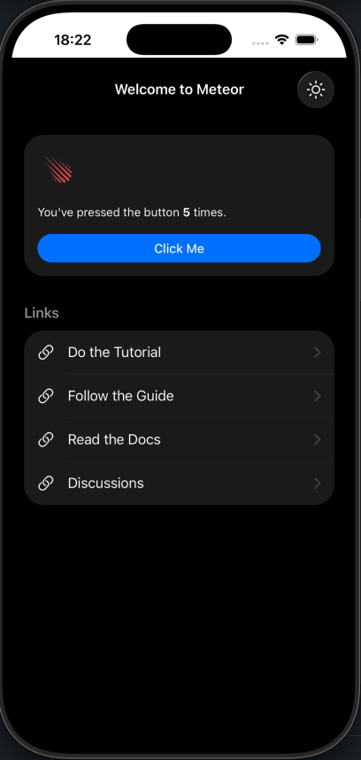

# Welcome Meteor Cordova

A full-stack mobile application built with Meteor 3.6.1 and React 18, targeting iOS and Android via Cordova. Uses Konsta UI for native-looking components, Tailwind CSS 4 for styling, and Rspack for bundling.

## Screenshots

| iOS | Android |
|-----|---------|
|  |  |
|  |  |

## Tech Stack

- **Meteor 3.6.1**: Full-stack framework with real-time data via DDP
- **React 18** — UI library
- **Konsta UI** — Mobile UI components with iOS/Material Design theming
- **Tailwind CSS 4** — Utility-first CSS
- **Rspack** — Bundler
- **MongoDB** — Database
- **Cordova** — Native mobile builds (iOS & Android)

## Prerequisites

- [Meteor](https://www.meteor.com)
- [Cordova Steps](https://docs.meteor.com/about/cordova.html)
- [Xcode](https://developer.apple.com/xcode/) (for iOS)
- [Android Studio](https://developer.android.com/studio), JDK 17, Android SDK Platform 36, Build Tools 36.0.0, and the latest Android SDK Command-line Tools (for Android)

## Getting Started

Install dependencies:

```bash
meteor npm ci
```

Run in the browser:

```bash
meteor run
```

Run on iOS simulator:

```bash
meteor run ios
```

If Cordova picks an unavailable simulator, run `meteor run ios-device`. In the Xcode project that opens, select an available simulator and run the app from Xcode. Keep the Meteor command running in your terminal.

Run on Android emulator:

```bash
meteor run android --mobile-server http://10.0.2.2:3000
```

## Native tests with Maestro

Install the [Maestro CLI](https://docs.maestro.dev/maestro-cli/how-to-install-maestro-cli) and boot an Android emulator or iOS simulator. Run the app using the command for that platform above. Once it opens, leave Meteor running so the app can load its links from the server.

From the app directory in a second terminal, run the smoke test for a quick check after a Meteor upgrade.

```bash
npm run test:native:smoke
```

The smoke flow relaunches the app and waits for the welcome screen and a link from the Meteor publication. To also check that tapping **Click Me** updates the counter, run both flows.

```bash
npm run test:native
```

The same flows work on Android and iOS. If both are running, pick the target with `npm run test:native -- --platform android` or `npm run test:native -- --platform ios`. To select a specific emulator or simulator, pass `--device <device-id>` after `--`.
