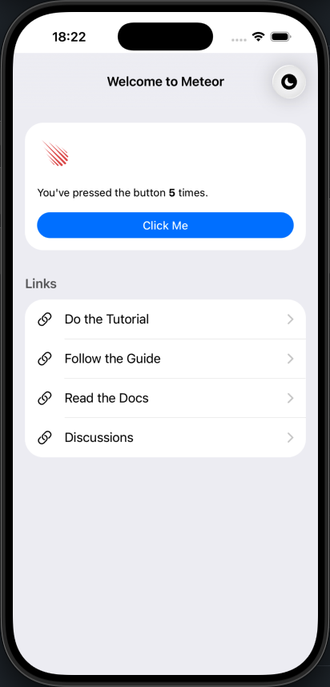
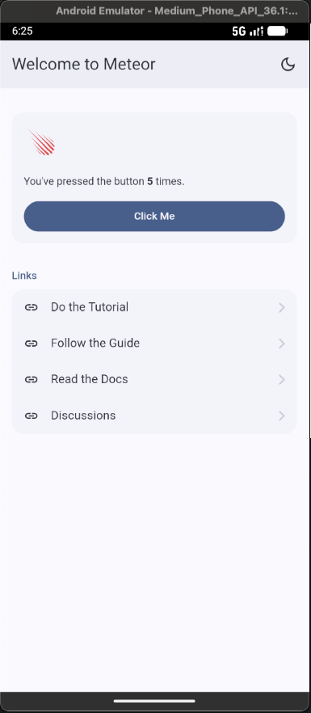
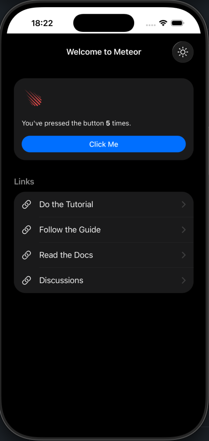
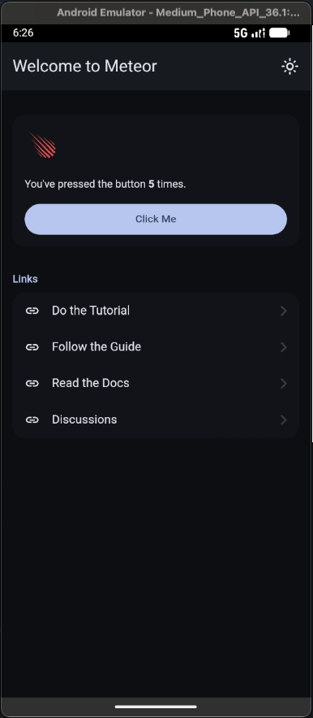

# Welcome Meteor Cordova

A full-stack mobile application built with Meteor 3.6.1 and React 18, targeting iOS and Android via Cordova. Uses Konsta UI for native-looking components, Tailwind CSS 4 for styling, and Rspack for bundling.

## Screenshots

| iOS | Android |
|-----|---------|
|  |  |
|  |  |

## Tech Stack

- **Meteor 3.6.1**: Full-stack framework with real-time data via DDP
- **React 18** — UI library
- **Konsta UI** — Mobile UI components with iOS/Material Design theming
- **Tailwind CSS 4** — Utility-first CSS
- **Rspack** — Bundler
- **MongoDB** — Database
- **Cordova** — Native mobile builds (iOS & Android)

## Prerequisites

- [Meteor](https://www.meteor.com)
- [Cordova Steps](https://docs.meteor.com/about/cordova.html)
- [Xcode](https://developer.apple.com/xcode/) (for iOS)
- [Android Studio](https://developer.android.com/studio) (for Android)

## Getting Started

Install dependencies:

```bash
meteor npm install
```

Run in the browser:

```bash
meteor run
```

Run on iOS simulator:

```bash
meteor run ios
```

Run on Android emulator:

```bash
meteor run android --mobile-server http://10.0.2.2:3000
```
