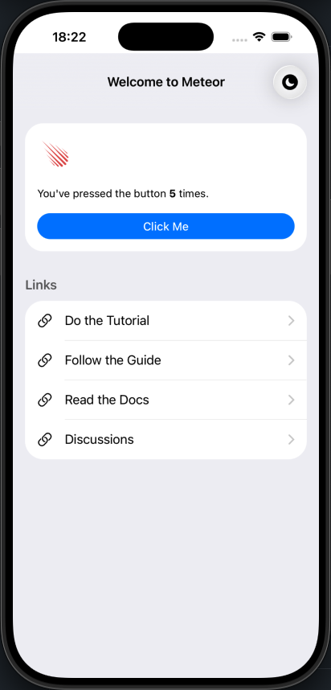
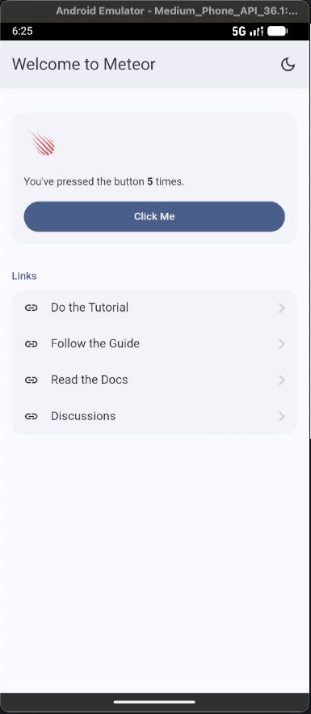
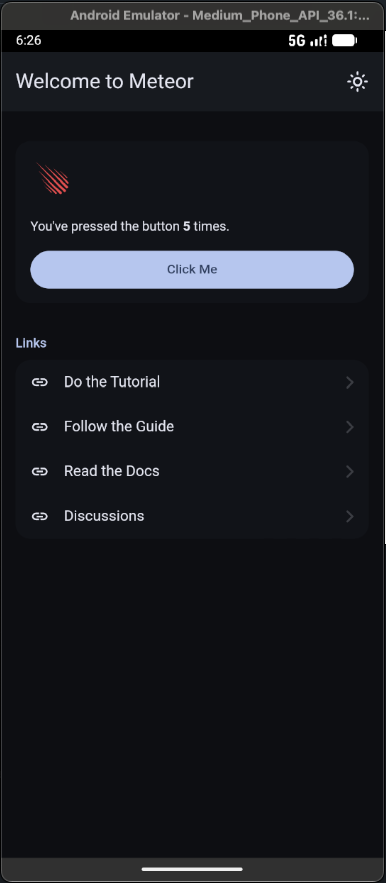

# Welcome Meteor Cordova

A full-stack mobile application built with Meteor 3.4 and React 18, targeting iOS and Android via Cordova. Uses Konsta UI for native-looking components, Tailwind CSS 4 for styling, and Rspack for bundling.

## Capacitor transition

The default branch continues to use Cordova. An experimental Capacitor transition
is reviewed separately in [PR #4](https://github.com/CloudByGalaxy/welcome-meteor-cordova/pull/4).
While that PR is open, see its [preview branch](https://github.com/CloudByGalaxy/welcome-meteor-cordova/tree/capacitor-transition)
and [migration guide](https://github.com/CloudByGalaxy/welcome-meteor-cordova/blob/capacitor-transition/MIGRATION.md).
Reviewed migration changes land on the separate [`capacitor-migration` branch](https://github.com/CloudByGalaxy/welcome-meteor-cordova/tree/capacitor-migration).

The transition uses [PR #3's Meteor 3.6.1 and Maestro baseline](https://github.com/CloudByGalaxy/welcome-meteor-cordova/pull/3),
preserving the same application UI, server behavior and original test flows.
The [comparison against that pinned baseline](https://github.com/CloudByGalaxy/welcome-meteor-cordova/compare/b6f4f8bb614e1c3b53e4d5c2941791736a5a9015...capacitor-transition)
shows the native project, dependency and configuration changes.

This requires a matching experimental Meteor checkout and a pending native
startup-timeout follow-up. The guide records those requirements, locally executed
Android/iOS checks, and the remaining signing and installed-app upgrade validation.

## Screenshots

| iOS | Android |
|-----|---------|
|  |  |
|  |  |

## Tech Stack

- **Meteor 3.4** — Full-stack framework with real-time data via DDP
- **React 18** — UI library
- **Konsta UI** — Mobile UI components with iOS/Material Design theming
- **Tailwind CSS 4** — Utility-first CSS
- **Rspack** — Bundler
- **MongoDB** — Database
- **Cordova** — Native mobile builds (iOS & Android)

## Prerequisites

- [Meteor](https://www.meteor.com)
- [Cordova Steps](https://docs.meteor.com/about/cordova.html)
- [Xcode](https://developer.apple.com/xcode/) (for iOS)
- [Android Studio](https://developer.android.com/studio) (for Android)

## Getting Started

Install dependencies:

```bash
meteor npm install
```

Run in the browser:

```bash
meteor run
```

Run on iOS simulator:

```bash
meteor run ios
```

Run on Android emulator:

```bash
meteor run android --mobile-server http://10.0.2.2:3000
```
