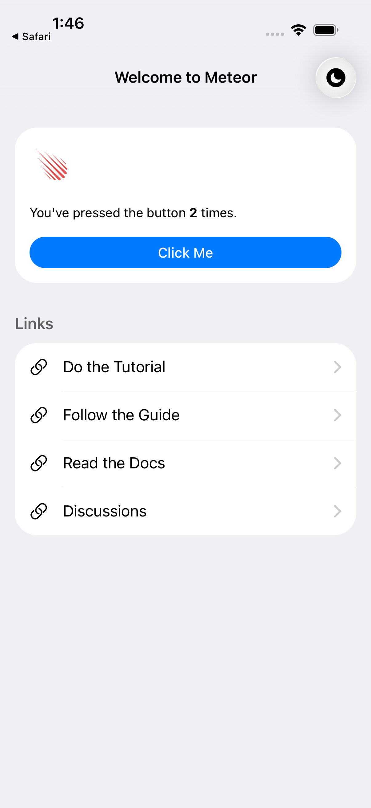
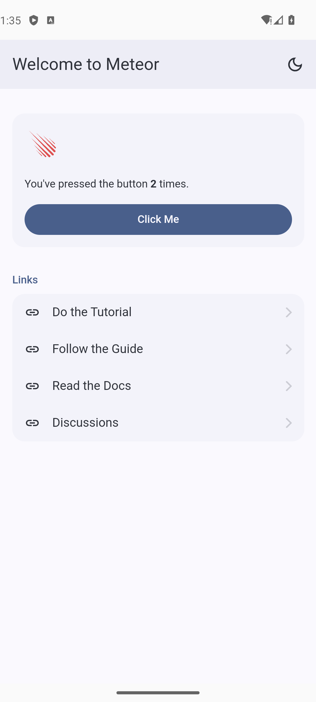
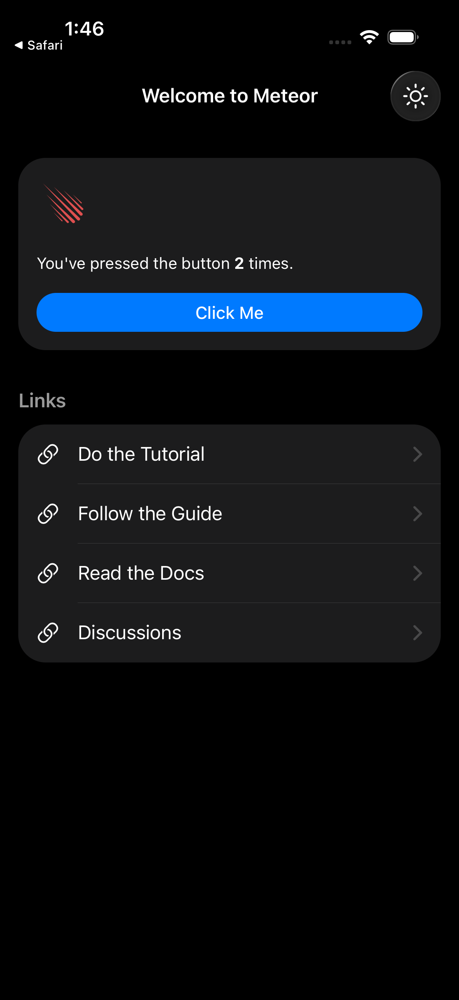
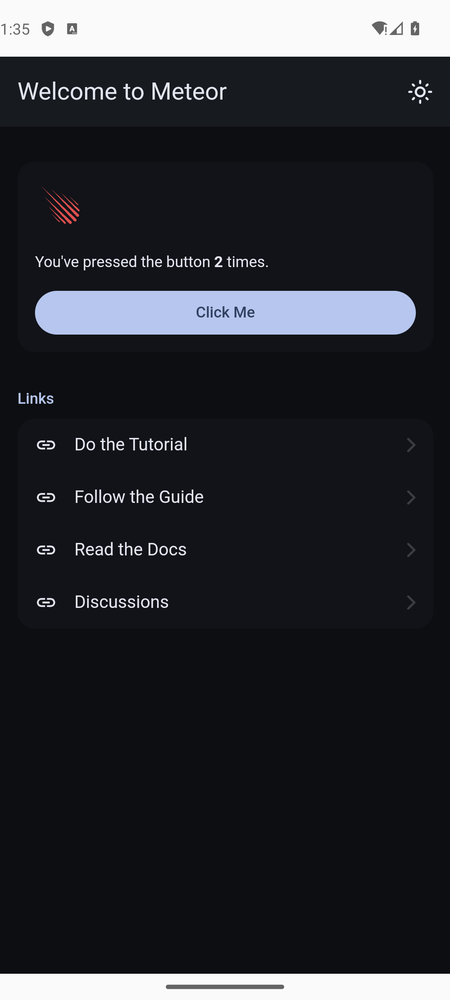

# Welcome Meteor Cordova

An experimental Capacitor migration of the Meteor 3.6.1 Cordova example, based on [PR #3](https://github.com/CloudByGalaxy/welcome-meteor-cordova/pull/3) at `b6f4f8b`. The React components, Konsta UI, Tailwind styling, Meteor publication and counter are preserved, along with both original Maestro flows.

The repository's [`main` branch](https://github.com/CloudByGalaxy/welcome-meteor-cordova/tree/main) remains the Cordova example. This transition is reviewed separately for the `capacitor-migration` branch. Its native projects are maintained in `android/` and `ios/`. See the [migration guide and validation record](MIGRATION.md) for the configuration mapping, tested baseline and remaining requirements.

This candidate requires the experimental Meteor integration in [meteor/meteor#14633](https://github.com/meteor/meteor/pull/14633). Preserving the 60-second startup deadline also requires a pending native-plugin follow-up that is currently local and has not been published. The validation below used that follow-up. Adding the configuration option alone to an older runtime does not preserve the deadline.

## Screenshots

| iOS | Android |
|-----|---------|
|  |  |
|  |  |

## Tech Stack

- **Meteor**: Full-stack framework with real-time data via DDP
- **React 18**: UI library
- **Konsta UI**: Mobile UI components with iOS/Material Design theming
- **Tailwind CSS 4**: Utility-first CSS
- **Rspack**: Bundler
- **MongoDB**: Database
- **Capacitor 8**: Android and iOS native projects, retaining Cordova InAppBrowser 6 through its compatibility layer

## Prerequisites

- A Meteor checkout containing the experimental Capacitor integration and the local startup-timeout change described below
- Node.js 22 or newer
- [Xcode](https://developer.apple.com/xcode/) 26 or newer and an available iOS Simulator (for iOS)
- [Android Studio](https://developer.android.com/studio), JDK 21, Android SDK Platform 36, Build Tools 36.0.0, and the Android SDK Command-line Tools (for Android)

## Getting Started

Select the integration checkout and install dependencies:

```bash
export METEOR_CHECKOUT=/path/to/meteor
export PATH="$METEOR_CHECKOUT:$PATH"
npm ci
npm link --no-save "$METEOR_CHECKOUT/npm-packages/meteor-capacitor" "$METEOR_CHECKOUT/npm-packages/meteor-rspack"
```

Both links are required for this source-checkout experiment. Reapply them after npm dependency installation. The manifest and lockfile retain registry versions and contain no machine-specific package paths.

Run in the browser:

```bash
meteor run
```

Run on iOS simulator:

```bash
meteor run ios
```

Set `METEOR_CAPACITOR_TARGET` to a simulator UDID or Android device ID when more than one target is available. Keep Meteor running while testing the app.

Run on Android emulator:

```bash
meteor run android --mobile-server http://10.0.2.2:3000
```

Run one Meteor command at a time in this app copy. Stop it before switching
platforms or running Mocha. The second terminal is for Maestro while the native
Meteor command stays running. When sharing a backend between platforms, use a
LAN address reachable by both; `10.0.2.2` is specific to the Android emulator.

## Native tests with Maestro

Install the [Maestro CLI](https://docs.maestro.dev/maestro-cli/how-to-install-maestro-cli) and boot an Android emulator or iOS simulator. Run the app using the command for that platform above. Once it opens, leave Meteor running so the app can load its links from the server.

From the app directory in a second terminal, run the smoke test for a quick check after a Meteor upgrade.

```bash
npm run test:native:smoke
```

The smoke flow relaunches the app and waits for the welcome screen and a link from the Meteor publication. To also check that tapping **Click Me** updates the counter, run both flows.

```bash
npm run test:native
```

The same flows work on Android and iOS. If both are running, pick the target with `npm run test:native -- --platform android` or `npm run test:native -- --platform ios`. To select a specific emulator or simulator, pass `--device <device-id>` after `--`.

The additional migration flow opens `Read the Docs` in the system browser,
checks the destination address, and returns without stopping the app. The
counter must retain its value and still increment:

```bash
npm run test:native:migration -- --platform android --device emulator-5554
```

Complete any first-run browser setup on the test device beforehand. This check
observes the browser's address and does not depend on the remote page loading.

### Real hot code push

Leave `meteor run android` or `meteor run ios` running in bundled mode. With
`METEOR_CHECKOUT` set, run this from a second terminal, substituting the selected
device and backend address:

```bash
npm --prefix "$METEOR_CHECKOUT/tools/native-tests" ci
npm run test:native:hcp -- --platform android --device emulator-5554 --server http://localhost:3000
```

The native-test dependency installation is needed once per prepared checkout.

The Node helper reuses Meteor's native-test manifest and Maestro helpers. It
runs the original smoke flow, changes the navbar title temporarily, waits for a
new server manifest, observes the update without reinstalling, and verifies it
survives a cold launch with a working counter. It restores the source and checks
the original screen again. Reports go to `.native-test-results/`. Run platforms
sequentially because the check temporarily edits the same application source.
Livereload configurations are rejected. Keep the source unchanged while this
check is running; unexpected concurrent edits are preserved and reported.

## Cordova migration decisions

- The native app ID remains `com.idq61wlm3rjzi.weftp5pcclxr`, and `.meteor/.id` is preserved. Android keeps version `0.0.1` and code `1`; iOS keeps marketing/build versions `0.0.1`, matching the generated Cordova baseline. Matching IDs alone does not establish a signed upgrade from an existing installation.
- `cordova-plugin-inappbrowser@6.0.0` is installed through npm. The existing `_system` call and browser fallback remain in `Info.jsx`.
- `mobile-config.js` and `.meteor/cordova-plugins` are retained as the original Cordova configuration reference. Capacitor does not consume either file.
- `plugins.CapacitorMeteorWebApp.startupTimeout: 60000` explicitly preserves `WebAppStartupTimeout`. This option requires the accompanying local Meteor native-plugin changes. Rebuild the native apps when changing it. Maestro's 60-second waits are separate test bounds.
- Cordova's `LoadUrlTimeoutValue` has no direct mapping here. Capacitor starts from bundled web assets; cold-start and HCP checks must establish the intended behavior.
- The metadata under `.meteor/` was adapted with the checkout's existing `meteor create --from` path before adding `capacitor`. The `none` release and checkout package versions are local development setup, not a general instruction to remove an existing application's package constraints.

Keep generated web assets, plugin wrappers and build caches out of version control. Preserve the maintained native projects, application identity, version settings and any signing configuration. Release signing and installed-app data preservation require separate validation.
